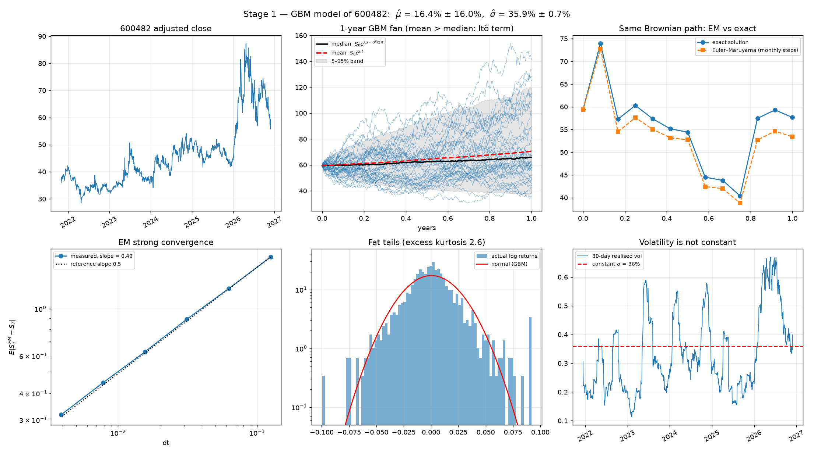
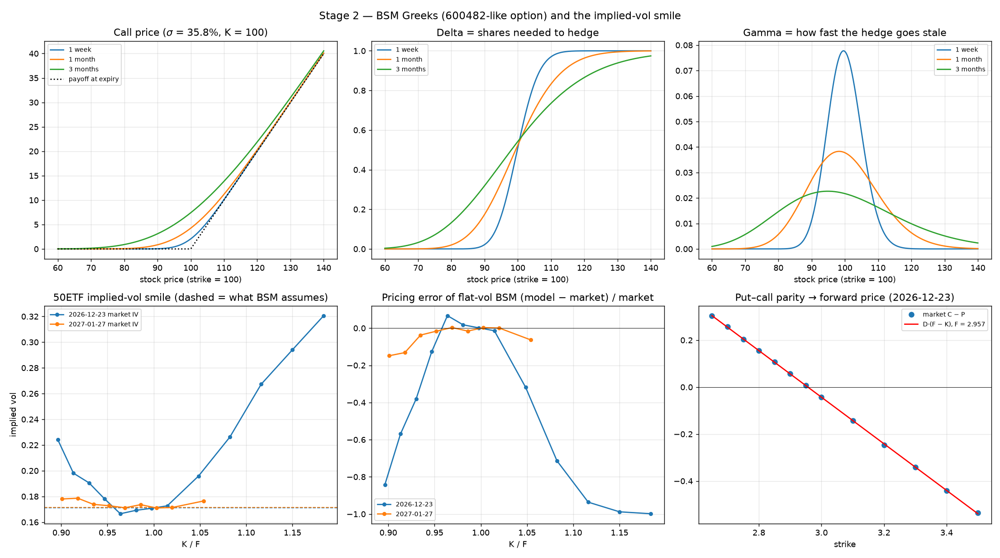
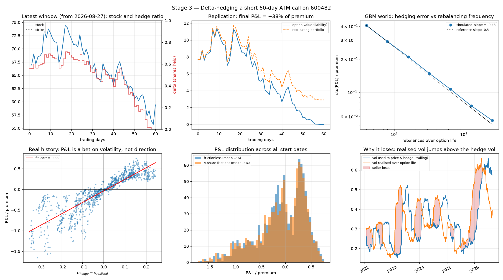
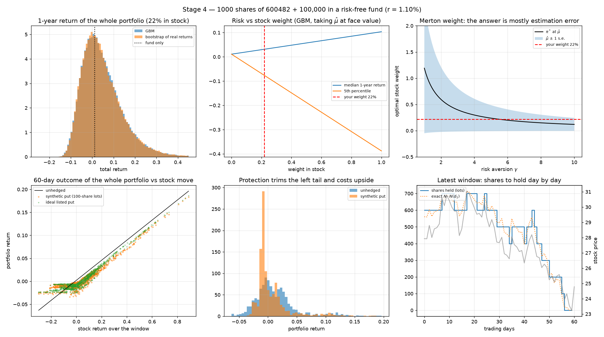

# Quant: from stochastic calculus to a real portfolio

The project works in four stages. Each stage builds on the previous one, uses real Chinese A-share market data (akshare, falling back to yfinance), and tests the textbook model against what actually happens. A GitHub Actions workflow re-runs everything after each trading day, saves the results by date, and refreshes the charts below.

## Daily results
Updated automatically after each A-share trading day by [the daily workflow](.github/workflows/daily.yml).

Note: σ and μ depend on which data source answered that day. akshare and yfinance adjust for dividends differently, so σ can differ by more than a percentage point between them (e.g. 35.8% vs 37.47%), well beyond its ~0.8% standard error. The *Data source* column says which one was used; compare rows from the same source.

<!-- RESULTS:START -->
**Latest trading day: 2026-11-27** · close 27.93 · [full log](reports/2026-11-27/log.txt)

| Date | Close | σ (annual) | μ (annual) | Excess kurtosis | 50ETF ATM IV | Hedge P&L / premium | Stock weight | 1-day VaR (hist.) | Data source |
|---|---|---|---|---|---|---|---|---|---|
| 2026-11-27 | 27.93 | 35.87% | 16.43% | 2.61 | 17.1% | -7.1% | 21.8% | 1,526 | akshare/eastmoney |
| 2026-11-26 | 26.08 | 37.47% | 16.39% | 2.63 | 14.4% | -6.3% | 20.7% | 1,475 | yfinance |
| 2026-11-25 | 26.45 | 35.78% | 15.40% | 2.63 | 15.0% | -7.2% | 20.9% | 1,446 | akshare/eastmoney |
| 2026-11-23 | 26.88 | 35.77% | 15.72% | 2.64 | 14.9% | -7.3% | 21.2% | 1,470 | akshare/eastmoney |
| 2026-11-20 | 28.10 | 35.74% | 16.54% | 2.66 | 14.9% | -7.3% | 21.9% | 1,537 | akshare/eastmoney |
| 2026-11-19 | 28.88 | 35.74% | 17.06% | 2.66 | 13.4% | -7.4% | 22.4% | 1,580 | akshare/eastmoney |
| 2026-11-18 | 28.76 | 35.75% | 17.00% | 2.66 | 13.9% | -7.4% | 22.3% | 1,574 | akshare/eastmoney |
| 2026-11-17 | 28.30 | 35.76% | 16.71% | 2.66 | 13.5% | -7.5% | 22.1% | 1,549 | akshare/eastmoney |
| 2026-11-13 | 28.47 | 37.47% | 17.91% | 2.65 | 13.8% | -6.6% | 22.2% | 1,612 | yfinance |

Showing the last 9 of 9 trading days. Full record: [reports/history.csv](reports/history.csv)
<!-- RESULTS:END -->

## Stage 1: Geometric Brownian Motion (`stage1_gbm.py`)
- Estimates drift μ and volatility σ from log returns, with standard errors. These show that μ is far less precisely known than σ.
- Simulates GBM with Euler–Maruyama and with the exact Itô solution on the same Brownian paths, and confirms the strong convergence order of ½.
- Tests the model's assumptions: fat tails (excess kurtosis, Jarque–Bera test), volatility clustering, and days that hit the price limit.



## Stage 2: Black–Scholes, Greeks and implied volatility (`stage2_bsm_iv.py`)
- A Black–Scholes pricer with exact formulas for the Greeks, checked against finite differences.
- Greek profiles for an option on the Stage 1 stock.
- An implied-volatility smile from real SSE 50ETF options, since A-shares have no single-stock options. The forward price and discount factor are backed out of put–call parity.



## Stage 3: Delta hedging (`stage3_delta_hedge.py`)
- In a GBM world, hedging error shrinks as O(N^-½) in the number of rebalances.
- A historical backtest sells a 3-month at-the-money call on every past date and hedges it with trailing realised volatility. The P&L follows vega × (σ_hedge − σ_realised).
- A-share trading frictions: commission, stamp duty on sales, and no trading at the daily price limits.



## Stage 4: Applying it to a real portfolio (`stage4_my_portfolio.py`)
- A risk snapshot: portfolio volatility, 1-day VaR (normal and historical), and the 1-year wealth distribution (GBM vs. resampled real returns).
- Merton's optimal stock weight π* = (μ − r)/(γσ²), and how sensitive it is to the hard-to-estimate μ.
- A synthetic protective put: replicates "shares + put" by moving money between the stock and a risk-free fund, in 100-share lots.



## Daily automation (`run_daily.py`)
Runs all four stages, puts the charts in `latest/` and dated archives in `reports/YYYY-MM-DD/`, and adds one summary row per day to `reports/history.csv`. Portfolio holdings come from environment variables (`SHARES`, `CASH`, `RATE`), so real positions never appear in the code.

The workflow is in `.github/workflows/daily.yml` and runs at 16:30 Beijing time, Monday to Friday. It can also be started by hand from the Actions tab.

## Getting started
```
pip install -r requirements.txt
python run_daily.py --demo     # offline test
python run_daily.py            # real data
```

Each stage can also be run on its own, for example `python stage1_gbm.py --demo`. Stages 3 and 4 import from `stage1_gbm.py`, so keep the scripts in the same folder.
